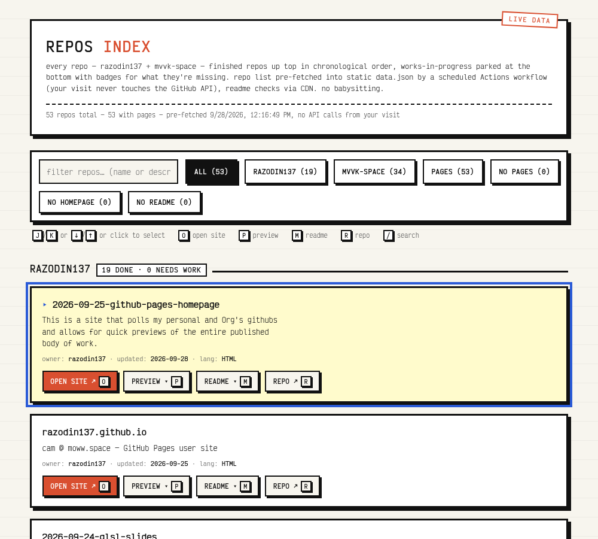

# repos-index

A single-file dashboard that lists every repo from [razodin137](https://github.com/razodin137) and the [mvvk-space](https://github.com/mvvk-space) org, each with one-click access to its published site, its GitHub repo, and an inline preview.

**Live at:** <https://razodin137.github.io/>



## Why

GitHub's repo list is a mess to click through. This gives a fast triage flow instead:

1. Scan the list — each card shows the repo name, description, language, and last-push date.
2. **"What's this about?"** — the description is right there.
3. **"Is it published?"** — if a site exists, OPEN SITE / PREVIEW buttons appear.
4. Move on, in seconds.

It's also a finishing checklist: a repo only earns its place in the main list once it's fully set up, and anything incomplete parks at the bottom with badges naming exactly what's still missing.

## Features

- **Finished repos up top, works-in-progress at the bottom** — a repo is "done" when it has all four: a description, Pages enabled, the homepage field set, and a README. Done repos list chronologically (newest first); incomplete ones sort to a dashed "NEEDS WORK" section at the bottom of each owner's list, ordered most-complete-first so totally empty repos sit at the very bottom. Once you finish a repo, it shows right up at the top like everything else.
- **Buttons appear only when usable** — OPEN SITE and PREVIEW require a site (homepage or Pages), the README button requires a README. No dead buttons, no checkmarks.
- **Per-repo missing badges** — incomplete repos show red badges for exactly what they lack: `DESCRIPTION`, `PAGES`, `HOMEPAGE`, `README`. While the README check is still running, the card shows a "checking readme…" note instead of guessing.
- **README detection without the API** — checked via jsDelivr's data API, with a raw.githubusercontent.com fallback for repos jsDelivr can't enumerate — cached in localStorage for 7 days.
- **Read the README inline** — every repo with a README gets a `README ▾` button (or press `M` with the card selected). The raw markdown drops straight into the card with a line/KB count, so you can eyeball README quality without leaving the page. No markdown renderer, no dependencies — just the text.
- **Counts on the filter buttons** — `PAGES (53)` shows the *combined* total across both accounts at a glance, no mental math.
- **Filters** — ALL / RAZODIN137 / MVVK-SPACE / PAGES / NO PAGES / NO HOMEPAGE / NO README. Use the "NO …" segments to see exactly what still needs publishing.
- **Live data, zero maintenance** — a scheduled GitHub Actions workflow re-fetches both repo lists into static `data.json` every 6 hours, so page loads never call the API at all. New repos and new pages sites appear on their own within hours — or instantly via the workflow's **Run workflow** button. No build step, no server, no API key, nothing to babysit.
- **Degrades instead of bricking** — if one owner's fetch fails (rate limit, API hiccup), the other owner still renders and the meta line says exactly what couldn't be fetched. If the API is fully rate-limited but a recent list is cached, the page renders from cache with a note.
- **Site links from the repo's own `homepage` field** — falls back to `https://<owner>.github.io/<repo>/` when a repo has Pages enabled but no homepage set.
- **Search** — live filter across names and descriptions.
- **Inline preview** — embeds the published site in an iframe without leaving the page.
- **Neobrutalist wireframe styling** — ink borders, hard shadows, Courier New, ruled-paper background.

## data.json as a feed for other pages

`data.json` isn't just this dashboard's cache — it's a public feed. Any other static page can fetch it (GitHub Pages sends `access-control-allow-origin: *`) and do its own thing with the data. Each repo entry carries a `topics` array straight from the GitHub API, so topic tags become a cross-page selection mechanism:

- **`marquee` topic** — consumed by the [INDEX_OF_WORKS portfolio marquee](https://github.com/razodin137/2026-01-28-portfolio-page-marquee). Tag any repo `marquee` on GitHub (repo page → About → gear icon → topics) and it auto-appears in that site's scrolling banner after the next data refresh. No code edits anywhere.

To add another consumer, filter `data.json` by your own topic and build whatever you want from the fields (`name`, `description`, `homepage`, `has_pages`, `topics`, …).

## Keyboard shortcuts

| Key | Action |
| --- | --- |
| `J` / `K` or `↓` / `↑` | select next / previous repo |
| click | select any repo |
| `O` | open the selected repo's **site** in a new tab |
| `P` | toggle inline **preview** of the site |
| `M` | expand the selected repo's **README** |
| `R` | open the **repo** on GitHub |
| `/` | focus the search box (`Esc` / `Enter` to leave) |

## How it works

The whole thing is one static page — `index.html` (markup + logic), `style.css` (styling, split out so other pages can reuse it), and `data.json` (the pre-fetched repo list). On load the page fetches `data.json` and renders the cards — a visit makes no API calls at all.

`data.json` is kept current by [`.github/workflows/refresh-data.yml`](.github/workflows/refresh-data.yml), which runs [`scripts/fetch-data.mjs`](scripts/fetch-data.mjs) every 6 hours (and on demand via **Actions → Refresh data.json → Run workflow**). The script fetches

```
GET https://api.github.com/users/<owner>/repos?per_page=100
```

for each owner using the workflow's built-in `GITHUB_TOKEN`, writes `data.json`, and commits it when anything changed. Commits pushed with `GITHUB_TOKEN` don't trigger the branch-based Pages build (GitHub suppresses that to prevent workflow loops), so the workflow then requests the rebuild explicitly — and the site updates itself. New repos appear within ~6 hours, or instantly with the Run button. When nothing changed the workflow commits nothing, except for one `fetchedAt` stamp-bump per day that keeps the repo "active" (GitHub auto-disables cron workflows after 60 days with no commits).

**Rate-limit strategy (learned the hard way):**

- **Repo lists never come from the visitor's browser.** The workflow pre-fetches them into static `data.json`; loading the page — or a bot hammering it — costs zero API quota. The original live client-side fetch survives as a fallback if `data.json` ever fails to load, and it keeps its old defenses:
  - **ETag conditional requests** — on repeat visits, `If-None-Match` returns `304 Not Modified`, which *doesn't count* against the limit.
  - **…but only for 10 minutes** (`ETAG_TTL`). GitHub's list ETags do **not** change when you flip `has_pages` on a repo (enabling Pages doesn't touch `updated_at`), so an unconditional etag match would happily serve a stale cached list forever — the dashboard once swore only 19 repos had pages when the real combined total was 53. Past the TTL, the page refetches and pays 1 request per owner. Worst case with heavy reload-testing: ~12 requests/hour — still comfortably under the limit.
  - **localStorage fallback** — the last successful list is cached (versioned + shape-checked so stale cache formats can't be misread); if the limit is ever hit, the page renders from cache with a "showing cached list" note, and per-owner failures don't brick the page.
- **README checks and README contents never touch `api.github.com`** (one call per repo would exhaust the limit instantly). File listings come from [jsDelivr's data API](https://data.jsdelivr.com) — no rate limit, full CORS — and README content is fetched as raw markdown from `raw.githubusercontent.com` (also CDN-served, no API limit). Repos too big for jsDelivr to enumerate fall back to probing the raw endpoint directly. Results cached in localStorage for 7 days.
- **No token ever reaches the browser.** A personal access token in client-side code would be readable by anyone visiting the page, and GitHub auto-revokes tokens it finds in public files. The workflow's `GITHUB_TOKEN` is minted fresh each run, expires when the run ends, and never touches the site — repo secrets are visible only to Actions, never to the published Pages files. If private repos should ever be included, add a fine-grained read-only PAT as the `GH_PAT` repo secret and the workflow uses it automatically.

## Adding more owners

Edit the `OWNERS` array near the top of the script in `index.html`:

```js
const OWNERS = ["razodin137", "mvvk-space"];
```

Any user or org works — the API endpoint is the same.

## Embedding caveat

Some sites (GitHub itself, sites with `X-Frame-Options: DENY`, etc.) refuse to be iframed and will render blank in the preview. The OPEN SITE button always works.

## Deployment

Any static host works. This repo is the `razodin137.github.io` user site, served by GitHub Pages from the `main` branch — a normal push to `main` redeploys automatically. The one exception is commits pushed by the workflow's `GITHUB_TOKEN` (GitHub suppresses the build they would trigger), so the workflow requests its own Pages build afterwards:

```
gh api -X POST repos/<you>/<repo>/pages/builds
```

## License

No license — it's a personal utility. Do what you want.